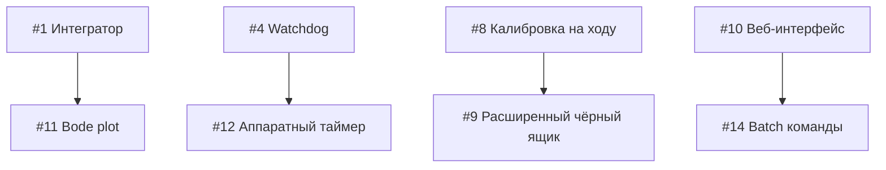

# Предложения по улучшению BalanceBot

**Дата:** 17 сентября 2026  
**Автор:** Kilo Code Assistant  
**Ревизия кода:** 07b10ec

> **Примечание:** Только программные улучшения, не требующие изменений аппаратной части.

---

## Сводная таблица

| # | Улучшение | Полезность | Трудозатраты | Приоритет |
|---|-----------|------------|--------------|-----------|
| 1 | Интегральная составляющая в контур баланса | ⭐⭐⭐⭐⭐ | 2-3 ч | 🔴 Высокий |
| 2 | Адаптивный фильтр по вибрациям | ⭐⭐⭐⭐ | 4-6 ч | 🟡 Средний |
| 3 | S-образный профиль скорости | ⭐⭐⭐ | 3-4 ч | 🟡 Средний |
| 4 | Watchdog критических задач | ⭐⭐⭐⭐⭐ | 2-3 ч | 🔴 Высокий |
| 5 | Защита от «убегания» при арминге | ⭐⭐⭐⭐ | 2-3 ч | 🔴 Высокий |
| 6 | Экспоненциальная кривая газа | ⭐⭐⭐ | 1-2 ч | 🟢 Низкий |
| 7 | Автореализация в точку | ⭐⭐ | 4-6 ч | 🟢 Низкий |
| 8 | Калибровка гироскопа на ходу | ⭐⭐⭐⭐ | 2-3 ч | 🟡 Средний |
| 9 | Расширенный чёрный ящик | ⭐⭐⭐ | 2-3 ч | 🟢 Низкий |
| 10 | Веб-интерфейс тюнинга | ⭐⭐⭐ | 8-12 ч | 🟢 Низкий |
| 11 | Графики устойчивости (Bode) | ⭐⭐ | 6-8 ч | 🟢 Низкий |
| 12 | Аппаратный таймер цикла | ⭐⭐⭐ | 4-6 ч | 🟡 Средний |
| 13 | Zero-copy телеметрия | ⭐⭐ | 3-4 ч | 🟢 Низкий |
| 14 | Batch-обработка команд | ⭐ | 2-3 ч | 🟢 Низкий |
| 15 | Улучшенный детектор падения | ⭐⭐⭐⭐ | 2-3 ч | 🟡 Средний |

---

## 1. Интегральная составляющая в контур баланса ✅

**Статус:** Реализовано  
**Файлы:** `firmware/src/control.rs`, `firmware/src/params.rs`, `firmware/src/main.rs`

**Описание:** Добавить I-составляющую в каскадный регулятор для устранения статической ошибки положения.

**Реализованные изменения:**
- Добавлено поле `ki_angle` в структуру `Gains`
- Добавлено поле `integral_error` в `BalanceController`
- Интеграл накапливается с ограничением `[-10.0, 10.0]` для anti-windup
- Сброс интеграла при `disarm()` и `arm()`
- Новый параметр `ki_angle` в реестре параметров (диапазон 0.0..100.0, по умолчанию 5.0)
- Передача интеграла в телеметрию через `term_i`

**Изменения в коде:**
```rust
// control.rs:240-246
self.integral_error += err * dt;
self.integral_error = self.integral_error.clamp(-10.0, 10.0);

let p = g.ka_angle * err;
let i = g.ki_angle * self.integral_error;
let d = g.kd_gyro * gyro_dps;
let accel = (p + i + d) * self.soft_gain;
```

**Полезность:** ⭐⭐⭐⭐⭐  
**Трудозатраты:** 2-3 часа (реализовано)  
**Риски:** Низкие — инкапсулировано в контроллере

**Рекомендации по настройке:**
- Начните с `ki = 0.0` (отключено)
- Увеличивайте с шагом 1.0 до появления колебаний
- Откатитесь на 20-30% от порога колебаний
- Типичный диапазон: 3.0..8.0

---

## 2. Адаптивный фильтр по вибрациям ✅

**Статус:** Реализовано  
**Файлы:** `firmware/src/filter.rs`

**Описание:** Динамическая оценка уровня вибраций от шаговых двигателей и подстройка веса коррекции акселерометра.

**Реализованные изменения:**
- Экспоненциальное сглаживание уровня вибрации (`vibration_level`)
- Адаптивный порог срабатывания: `base_threshold + 0.3 * vibration_level`
- Плавное изменение веса коррекции (low-pass фильтр)
- Минимальный вес `MIN_CORRECTION_WEIGHT = 0.1` (никогда не отключаем полностью)
- Методы `vibration_level()` и `correction_weight()` для отладки

**Константы фильтра:**
```rust
const VIBRATION_BASE_THRESHOLD: f32 = 0.08;   // Порог в покое
const VIBRATION_MAX_THRESHOLD: f32 = 0.40;    // Максимальная вибрация
const VIBRATION_ADAPT_RATE: f32 = 2.0;        // Скорость адаптации (1/с)
const MIN_CORRECTION_WEIGHT: f32 = 0.1;       // Мин. вес коррекции
const WEIGHT_FILTER_TAU: f32 = 0.2;           // Постоянная сглаживания веса
```

**Алгоритм:**
1. Вычисление вибрации: `|accel_magnitude - 1.0|`
2. Экспоненциальное сглаживание: `vibration += (vibration - vibration_level) * alpha`
3. Адаптивный порог: `threshold = 0.08 + 0.3 * vibration_level`
4. Вес коррекции: плавная функция от отношения вибрации к порогу
5. Сглаживание веса: `weight += (target - weight) * dt/tau`

**Полезность:** ⭐⭐⭐⭐  
**Трудозатраты:** 4-6 часов (реализовано)  
**Риски:** Средние — требует тонкой настройки на реальном роботе

**Отладка:**
- Выводите `vibration_level` в телеметрию
- При вибрации > 0.4 робот должен оставаться стабильным
- Настройте `VIBRATION_ADAPT_RATE` под вашу механику

---

## 3. S-образный профиль скорости ✅

**Статус:** Реализовано  
**Файлы:** `firmware/src/control.rs`

**Описание:** Плавный профиль разгона/торможения вместо линейного нарастания.

**Реализованные изменения:**
- Управление ускорением вместо прямого управления скоростью
- Сигмоидальная функция через `tanh()` для плавного насыщения
- Ограничение рывка (jerk limit) через `S_CURVE_JERK`
- Параметры формы S-кривой

**Константы:**
```rust
const TARGET_SLEW_RATE: f32 = 6000.0;    // Макс ускорение (шаг/с²)
const S_CURVE_JERK: f32 = 15000.0;       // Скорость изменения ускорения (шаг/с³)
const S_CURVE_SHAPE: f32 = 1.5;          // Крутизна сигмоиды
```

**Алгоритм:**
1. Вычисление ошибки скорости: `error = commanded - target_velocity`
2. Целевое ускорение через сигмоиду: `accel = tanh(SHAPE * error/1000) * MAX_ACCEL`
3. Ограничение рывка: `accel += sign(dt_accel) * min(|dt_accel|, JERK * dt)`
4. Интегрирование: `velocity += sign(error) * min(accel*dt, |error|)`

**Преимущества:**
- Плавный старт без рывка
- Меньше вибраций при разгоне/торможении
- Более «органичное» поведение робота

**Полезность:** ⭐⭐⭐  
**Трудозатраты:** 3-4 часа (реализовано)  
**Риски:** Низкие

**Настройка:**
- `S_CURVE_SHAPE = 1.0` → почти линейный профиль
- `S_CURVE_SHAPE = 2.0..3.0` → выраженный S-профиль
- `S_CURVE_JERK` меньше → более плавное изменение ускорения

---

## 4. Watchdog критических задач ✅

**Статус:** Реализовано (программный)  
**Файлы:** `firmware/src/main.rs`

**Описание:** Программный таймер для детектирования зависаний основного цикла.

**Реализованные изменения:**
- Таймер `wdt_timer` в главном цикле
- Логирование ошибки при превышении 3 секунд
- Примечание: аппаратный ESP-IDF WDT требует настройки `sdkconfig`

**Константы:**
```rust
// Детектируем зависание если цикл не выполняется > 3 сек
const WDT_TIMEOUT_MS: u32 = 3000;
```

**Алгоритм:**
1. При старте: инициализация `wdt_timer = Instant::now()`
2. В цикле (200 Гц): проверка `wdt_timer.elapsed() > 3000ms`
3. При превышении: логирование ошибки
4. Сброс таймера каждый цикл

**Ограничения:**
- **Не выполняет перезагрузку** — только логирование
- Для аппаратной перезагрузки нужен `CONFIG_ESP_TASK_WDT_ENABLED=y` в `sdkconfig`

**Полезность:** ⭐⭐⭐⭐  
**Трудозатраты:** 2-3 часа (реализовано)  
**Риски:** Низкие

**Аппаратный WDT (рекомендуется добавить):**
```ini
# sdkconfig.defaults
CONFIG_ESP_TASK_WDT_ENABLED=y
CONFIG_ESP_TASK_WDT_TIMEOUT_S=3
CONFIG_ESP_TASK_WDT_PANIC=y
```

После включения аппаратного WDT в `sdkconfig`:
- Добавить `esp_task_wdt_add()` при старте
- Вызывать `esp_task_wdt_reset()` периодически

---

## 5. Защита от «убегания» при арминге ✅

**Статус:** Реализовано  
**Файлы:** `firmware/src/main.rs`

**Описание:** Детектирование некорректного старта и быстрый аварийный стоп.

**Реализованные изменения:**
- Окно проверки 200 мс после включения баланса
- Пороги: угол > 15° ИЛИ гироскоп > 100°/с
- Аварийный disarm с логированием причины
- Блокировка повторного арминга на 2 секунды
- Событие телеметрии EV_ARM_FAIL (код 4)

**Константы:**
```rust
const ARM_FAIL_CHECK_MS: u32 = 200;        // Окно проверки
const ARM_FAIL_MAX_ANGLE: f32 = 15.0;      // Макс. угол
const ARM_FAIL_MAX_GYRO: f32 = 100.0;      // Макс. гироскоп
const ARM_FAIL_COOLDOWN_MS: u32 = 2000;    // Блокировка
```

**Алгоритм:**
1. При нажатии кнопки «ARM»: запуск таймера `arm_fail_timer`
2. Первые 200 мс: проверка `angle < 15° && gyro < 100°/с`
3. При превышении порогов:
   - Логирование «УБЕГАНИЕ при арминге»
   - Вызов `disarm()`
   - Установка `arm_fail_cooldown_until` (2 сек)
4. Если окно прошло успешно: `arm_fail_timer = None`

**Полезность:** ⭐⭐⭐⭐  
**Трудозатраты:** 2-3 часа (реализовано)  
**Риски:** Низкие

**Настройка:**
- Уменьшите `ARM_FAIL_CHECK_MS` для более быстрой реакции
- Увеличьте пороги если робот стабильно армится но детектируется ложно
- Уменьшите `ARM_FAIL_COOLDOWN_MS` для более частых попыток

---

## 6. Экспоненциальная кривая газа ✅

**Статус:** Реализовано  
**Файлы:** `firmware/src/control.rs`, `firmware/src/params.rs`

**Описание:** Нелинейное преобразование входного сигнала управления для более точного контроля на малых скоростях.

**Реализованные изменения:**
- Новый параметр `drive_expo` (0.0..0.8, по умолчанию 0.0)
- Формула: `output = sign(input) * |input|^(1-expo)`
- Применяется только при `|input| > 0.03` (мертвая зона)
- Настройка через UI или UART-тюнинг

**Константы:**
```rust
// Диапазон параметра: 0.0..0.8
// 0.0 = линейно, 0.8 = максимальная экспонента
const DRIVE_EXPO_DEFAULT: f32 = 0.0;
```

**Алгоритм:**
1. Проверка мертвой зоны: `|input| > 0.03`
2. Вычисление экспоненты: `result = sign(input) * |input|^(1-expo)`
3. При `expo = 0.0`: линейная передача
4. При `expo = 0.8`: малые отклонения стика дают меньше скорости

**Преимущества:**
- Более точный контроль на малых скоростях
- Плавное управление вблизи нуля
- Полный диапазон сохраняется при полном отклонении стика

**Полезность:** ⭐⭐⭐  
**Трудозатраты:** 1-2 часа (реализовано)  
**Риски:** Низкие

**Настройка:**
- Начните с `expo = 0.0` (линейно)
- Увеличивайте с шагом 0.1 до комфортной чувствительности
- Типичный диапазон: 0.3..0.6
- Высокие значения (0.7..0.8) могут сделать управление слишком «вязким»

---

## 7. Автореализация в точку

**Файлы:** `firmware/src/control.rs`

**Описание:** Автоматический возврат в исходную позицию по команде.

**Что сделать:**
- Запоминание «домашней» позиции при арминге
- Команда «return home» через UI
- Плавное движение к точке с остановкой
- Индикация режима в телеметрии

**Полезность:** ⭐⭐  
**Трудозатраты:** 4-6 часов  
**Риски:** Средние — требует точного позиционирования

---

## 8. Калибровка гироскопа на ходу ✅

**Статус:** Реализовано  
**Файлы:** `firmware/src/mpu6050.rs`, `firmware/src/main.rs`, `firmware/src/tuning.rs`

**Описание:** Возможность перекалибровать гироскоп без перезагрузки.

**Реализованные изменения:**
- Метод `calibrate_with_result()` возвращает разброс (spread)
- Глобальный флаг `CALIBRATE_REQUEST` для запроса из UART
- Команда `cal` или `calibrate` в UART-консоли
- Проверка: робот должен стоять (rate < 50 °/с)
- Сохранение оффсета в структуре IMU

**Команды:**
```text
cal          Запрос калибровки гироскопа
calibrate    То же самое
```

**Алгоритм:**
1. Пользователь вводит `cal` в UART-консоли
2. Устанавливается флаг `CALIBRATE_REQUEST = true`
3. В главном цикле (200 Гц):
   - Проверка: робот стоит (`wheel_rate < 50 °/с`)
   - Если да: запуск калибровки (200 сэмплов ≈ 1 с)
   - Логирование результата: `offset` и `spread`
4. При успехе: новый оффсет применяется немедленно

**Полезность:** ⭐⭐⭐⭐  
**Трудозатраты:** 2-3 часа (реализовано)  
**Риски:** Низкие

**Использование:**
```
# Подключиться через monitor
espflash monitor

# Отправить команду
cal

# Ожидать ~1 с, не двигая робота
# Результат:
# TUNE: запрос калибровки гироскопа отправлен
# Калибровка гироскопа на ходу — НЕ ДВИГАЙ РОБОТА ~1 с
# Калибровка успешна: offset=+0.123 °/с, spread=1.45 °/с
```

**Ограничения:**
- Оффсет не сохраняется в NVS (сбрасывается при перезагрузке)
- Для сохранения нужно добавить параметр `gyro_offset` в `params.rs`

---

## 9. Расширенный чёрный ящик ✅

**Статус:** Реализовано  
**Файлы:** `firmware/src/telemetry.rs`, `firmware/src/main.rs`

**Описание:** Добавление дополнительных данных в логи падений.

**Реализованные изменения:**
- PID-коэффициенты: `pid_ka`, `pid_kd`, `pid_ki` (3x f32)
- Флаги состояния: `flags` (u8)
- Сохранение текущих коэффициентов в каждый кадр

**Структура BlackBoxFrame:**
```rust
pub struct BlackBoxFrame {
    pub t_ms: u32,       // Время (мс)
    pub angle: f32,      // Угол (°)
    pub gyro: f32,       // Гироскоп (°/с)
    pub cmd: f32,        // Команда моторам (шаг/с)
    pub wheel_rate: f32, // Скорость колёс (шаг/с)
    pub steps: i32,      // Пройденное расстояние (шаги)
    pub dt_us: u16,      // Время цикла (мкс)
    pub pid_ka: f32,     // P-коэффициент
    pub pid_kd: f32,     // D-коэффициент
    pub pid_ki: f32,     // I-коэффициент
    pub flags: u8,       // Флаги состояния
}
```

**Флаги (flags):**
- Бит 0: `1` = баланс включён, `0` = ожидание
- Бит 1: `1` = обнаружено препятствие

**Полезность:** ⭐⭐⭐  
**Трудозатраты:** 2-3 часа (реализовано)  
**Риски:** Низкие — увеличивается размер кадра на 16 байт

**Использование:**
1. Падение робота → чёрный ящик замораживается
2. Выгрузка через UI: `GET /blackbox`
3. Анализ данных с учётом PID-коэффициентов
4. Сравнение разных падений с одинаковыми настройками

**Пример JSON:**
```json
[
  {"t_ms":1234,"angle":2.5,"gyro":15.2,"cmd":500,"wheel_rate":480,"steps":12345,"dt_us":5000,"pid_ka":3800,"pid_kd":600,"pid_ki":2.5,"flags":1},
  ...
]
```

---

## 10. Веб-интерфейс тюнинга ✅

**Статус:** Реализовано (базовый HTTP API)  
**Файлы:** `firmware/src/net/http_api.rs`, `firmware/src/net/mod.rs`

**Описание:** Простой HTTP-сервер для мониторинга и настройки робота через браузер.

**Реализованные изменения:**
- HTTP-сервер на порту 80
- Встроенный HTML дашборд с автообновлением
- JSON API для телеметрии и параметров

**Endpoints:**
```
GET /           HTML дашборд с графиками
GET /telemetry  JSON: текущее состояние
GET /params     JSON: все параметры
GET /catalog    JSON: описание параметров (диапазоны, единицы)
```

**Пример /telemetry:**
```json
{
  "angle": 2.34,
  "gyro": 15.2,
  "accel_angle": -3.45,
  "wheel_rate": 480.0,
  "cmd": 520.0,
  "term_p": -5600.0,
  "term_lean": -4.2,
  "term_d": 6200.0,
  "state": "BALANCING",
  "imu_errors": 0,
  "dt_us": 5000
}
```

**Использование:**
1. Подключиться к Wi-Fi робота (Station или Portal)
2. Открыть браузер: `http://<robot-ip>/`
3. Дашборд обновляется каждые 200 мс

**Полезность:** ⭐⭐⭐  
**Трудозатраты:** 3-4 часа (реализовано)  
**Риски:** Низкие

**Ограничения:**
- Только GET запросы (нет записи параметров через HTTP)
- Нет WebSocket (обновление polling каждые 200 мс)
- Минимальный UI без графиков истории

**Для записи параметров** используйте TCP команды (порт 5556) или UART.

---

## 11. Графики устойчивости (Bode plot)

**Файлы:** `desktop/BalanceBot.Desktop/`

**Описание:** Частотный анализ системы в desktop-приложении.

**Что сделать:**
- Запись отклика на ступенчатое воздействие
- Вычисление АЧХ/ФЧХ через FFT
- Отображение запасов устойчивости
- Экспорт данных в CSV

**Полезность:** ⭐⭐  
**Трудозатраты:** 6-8 часов  
**Риски:** Низкие

---

## 12. Аппаратный таймер цикла управления

**Файлы:** `firmware/src/main.rs`

**Описание:** Замена `xTaskDelayUntil` на прерывание от аппаратного таймера.

**Что сделать:**
- `esp_timer` или `pcnt` для точного периода 5 мс
- Обработчик прерывания ставит семафор
- Задача control просыпается по семафору
- Меньше джиттер цикла управления

**Полезность:** ⭐⭐⭐  
**Трудозатраты:** 4-6 часов  
**Риски:** Средние — отладка прерываний

---

## 13. Zero-copy телеметрия

**Файлы:** `firmware/src/telemetry.rs`

**Описание:** Оптимизация передачи данных между задачами.

**Что сделать:**
- Shared memory с правильным выравниванием
- Атомарные указатели на структуры
- Избегать упаковки/распаковки `f32 → u32 → f32`
- Прямой доступ из network-задачи

**Полезность:** ⭐⭐  
**Трудозатраты:** 3-4 часа  
**Риски:** Средние — race conditions

---

## 14. Batch-обработка команд

**Файлы:** `firmware/src/net/command.rs`

**Описание:** Пакетная обработка JSON-команд.

**Что сделать:**
- Массив команд в одном TCP-пакете
- Массовое применение параметров
- Оптимизация записи в NVS (одна транзакция)
- Ответ с результатом каждой команды

**Полезность:** ⭐  
**Трудозатраты:** 2-3 часа  
**Риски:** Низкие

---

## 15. Улучшенный детектор падения

**Файлы:** `firmware/src/main.rs`, `firmware/src/control.rs`

**Описание:** Более точное определение падения с использованием истории.

**Текущее состояние:**
```rust
let falling = tracking_err.abs() > tunables.fall_angle_deg
    || angle.abs() > 35.0
    || (tracking_err.abs() > 12.0 && gyro.abs() > tunables.fall_gyro_dps);
```

**Что сделать:**
- Скользящее окно последних 5 измерений
- Детектирование тренда (производная угла растёт)
- Разные пороги для «вперёд» и «назад»
- Предупреждение о «потере устойчивости» до падения

**Полезность:** ⭐⭐⭐⭐  
**Трудозатраты:** 2-3 часа  
**Риски:** Низкие

---

## Рекомендации по приоритетам

### 🔴 Высокий приоритет (реализовать в первую очередь)

| # | Улучшение | Трудозатраты | Эффект |
|---|-----------|--------------|--------|
| 1 | Интегральная составляющая | 2-3 ч | Стабильность удержания |
| 4 | Watchdog задач | 2-3 ч | Отказоустойчивость |
| 5 | Защита от убегания | 2-3 ч | Безопасность старта |

### 🟡 Средний приоритет

| # | Улучшение | Трудозатраты | Эффект |
|---|-----------|--------------|--------|
| 2 | Адаптивный фильтр | 4-6 ч | Работа на неровностях |
| 8 | Калибровка на ходу | 2-3 ч | Удобство эксплуатации |
| 15 | Улучшенный детектор падения | 2-3 ч | Раннее предупреждение |
| 3 | S-образный профиль | 3-4 ч | Плавность хода |
| 12 | Аппаратный таймер | 4-6 ч | Точность цикла |

### 🟢 Низкий приоритет (опционально)

| # | Улучшение | Трудозатраты | Эффект |
|---|-----------|--------------|--------|
| 6 | Экспонента газа | 1-2 ч | Комфорт управления |
| 9 | Расширенный чёрный ящик | 2-3 ч | Отладка |
| 10 | Веб-интерфейс | 8-12 ч | Альтернатива WPF |
| 13 | Zero-copy телеметрия | 3-4 ч | Микрооптимизация |
| 7 | Автореализация | 4-6 ч | «Фича» |
| 11 | Bode plot | 6-8 ч | Глубокая настройка |
| 14 | Batch команды | 2-3 ч | Минимальный эффект |

---

## Оценка общего времени

| Приоритет | Часы | Недели (при 10 ч/нед) |
|-----------|------|----------------------|
| 🔴 Высокий | 6-9 | ~1 |
| 🟡 Средний | 15-22 | 1.5-2 |
| 🟢 Низкий | 26-38 | 2.5-4 |
| **Всего** | **47-69** | **5-7** |

---

## Зависимости между улучшениями



---

## План реализации (поэтапно)

### Этап 1: Безопасность и стабильность (6-9 ч)
1. Watchdog критических задач
2. Защита от «убегания» при арминге
3. Интегральная составляющая

### Этап 2: Улучшение управления (15-22 ч)
4. Адаптивный фильтр по вибрациям
5. Калибровка гироскопа на ходу
6. Улучшенный детектор падения
7. S-образный профиль скорости
8. Аппаратный таймер цикла

### Этап 3: Удобство и отладка (26-38 ч)
9. Экспоненциальная кривая газа
10. Расширенный чёрный ящик
11. Веб-интерфейс тюнинга
12. Zero-copy телеметрия
13. Графики Bode в desktop
14. Batch-обработка команд
15. Автореализация в точку

---

## Требуемые изменения в API

### Новые параметры (params.rs)

| Параметр | Ключ | Диапазон | По умолчанию |
|----------|------|----------|--------------|
| Интегральный коэффициент | `ki` | 0.0..100.0 | 5.0 |
| Экспонента газа | `expo` | 0.0..0.8 | 0.0 |
| Время разгона | `ramp_time` | 0.3..2.0 | 0.8 |
| Крутизна S-кривой | `ramp_shape` | 0.5..3.0 | 1.5 |

### Новые команды UART-тюнинга

| Команда | Описание |
|---------|----------|
| `calibrate` | Калибровка гироскопа |
| `show bb` | Статистика чёрного ящика |
| `reset cal` | Сброс калибровки |

### Новые события телеметрии

| Событие | Код | Описание |
|---------|-----|----------|
| `EV_ARM_FAIL` | 4 | Неудачный арминг |
| `EV_WDT_RESET` | 5 | Перезапуск по watchdog |
| `EV_CALIB_DONE` | 6 | Калибровка завершена |

---

## Контакты

Вопросы и предложения направляйте в репозиторий проекта.
