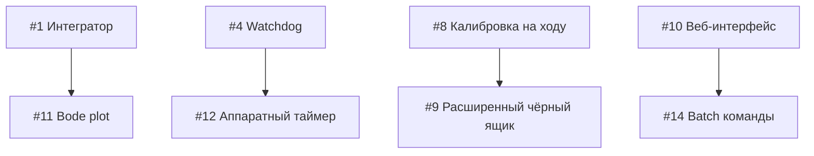

# Предложения по улучшению BalanceBot

**Дата:** 17 сентября 2026  
**Автор:** Kilo Code Assistant  
**Ревизия кода:** 07b10ec

> **Примечание:** Только программные улучшения, не требующие изменений аппаратной части.

---

## Сводная таблица

| # | Улучшение | Полезность | Трудозатраты | Приоритет |
|---|-----------|------------|--------------|-----------|
| 1 | Интегральная составляющая в контур баланса | ⭐⭐⭐⭐⭐ | 2-3 ч | 🔴 Высокий |
| 2 | Адаптивный фильтр по вибрациям | ⭐⭐⭐⭐ | 4-6 ч | 🟡 Средний |
| 3 | S-образный профиль скорости | ⭐⭐⭐ | 3-4 ч | 🟡 Средний |
| 4 | Watchdog критических задач | ⭐⭐⭐⭐⭐ | 2-3 ч | 🔴 Высокий |
| 5 | Защита от «убегания» при арминге | ⭐⭐⭐⭐ | 2-3 ч | 🔴 Высокий |
| 6 | Экспоненциальная кривая газа | ⭐⭐⭐ | 1-2 ч | 🟢 Низкий |
| 7 | Автореализация в точку | ⭐⭐ | 4-6 ч | 🟢 Низкий |
| 8 | Калибровка гироскопа на ходу | ⭐⭐⭐⭐ | 2-3 ч | 🟡 Средний |
| 9 | Расширенный чёрный ящик | ⭐⭐⭐ | 2-3 ч | 🟢 Низкий |
| 10 | Веб-интерфейс тюнинга | ⭐⭐⭐ | 8-12 ч | 🟢 Низкий |
| 11 | Графики устойчивости (Bode) | ⭐⭐ | 6-8 ч | 🟢 Низкий |
| 12 | Аппаратный таймер цикла | ⭐⭐⭐ | 4-6 ч | 🟡 Средний |
| 13 | Zero-copy телеметрия ✅ | ⭐⭐ | 3-4 ч | 🟢 Низкий |
| 14 | Batch-обработка команд ✅ | ⭐ | 2-3 ч | 🟢 Низкий |
| 15 | Улучшенный детектор падения ✅ | ⭐⭐⭐⭐ | 2-3 ч | 🟡 Средний |
| 16 | Автонастройка PID (кнопка в UI) | ⭐⭐⭐⭐⭐ | 4-6 ч | 🔴 Высокий |
| 17 | Управление с геймпада DualSense ✅ | ⭐⭐⭐⭐⭐ | 6-8 ч | 🔴 Высокий |

---

## 1. Интегральная составляющая в контур баланса ✅

**Статус:** Реализовано  
**Файлы:** `firmware/src/control.rs`, `firmware/src/params.rs`, `firmware/src/main.rs`

**Описание:** Добавить I-составляющую в каскадный регулятор для устранения статической ошибки положения.

**Реализованные изменения:**
- Добавлено поле `ki_angle` в структуру `Gains`
- Добавлено поле `integral_error` в `BalanceController`
- Интеграл накапливается с ограничением `[-10.0, 10.0]` для anti-windup
- Сброс интеграла при `disarm()` и `arm()`
- Новый параметр `ki_angle` в реестре параметров (диапазон 0.0..100.0, по умолчанию 5.0)
- Передача интеграла в телеметрию через `term_i`

**Изменения в коде:**
```rust
// control.rs:240-246
self.integral_error += err * dt;
self.integral_error = self.integral_error.clamp(-10.0, 10.0);

let p = g.ka_angle * err;
let i = g.ki_angle * self.integral_error;
let d = g.kd_gyro * gyro_dps;
let accel = (p + i + d) * self.soft_gain;
```

**Полезность:** ⭐⭐⭐⭐⭐  
**Трудозатраты:** 2-3 часа (реализовано)  
**Риски:** Низкие — инкапсулировано в контроллере

**Рекомендации по настройке:**
- Начните с `ki = 0.0` (отключено)
- Увеличивайте с шагом 1.0 до появления колебаний
- Откатитесь на 20-30% от порога колебаний
- Типичный диапазон: 3.0..8.0

---

## 2. Адаптивный фильтр по вибрациям ✅

**Статус:** Реализовано  
**Файлы:** `firmware/src/filter.rs`

**Описание:** Динамическая оценка уровня вибраций от шаговых двигателей и подстройка веса коррекции акселерометра.

**Реализованные изменения:**
- Экспоненциальное сглаживание уровня вибрации (`vibration_level`)
- Адаптивный порог срабатывания: `base_threshold + 0.3 * vibration_level`
- Плавное изменение веса коррекции (low-pass фильтр)
- Минимальный вес `MIN_CORRECTION_WEIGHT = 0.1` (никогда не отключаем полностью)
- Методы `vibration_level()` и `correction_weight()` для отладки

**Константы фильтра:**
```rust
const VIBRATION_BASE_THRESHOLD: f32 = 0.08;   // Порог в покое
const VIBRATION_MAX_THRESHOLD: f32 = 0.40;    // Максимальная вибрация
const VIBRATION_ADAPT_RATE: f32 = 2.0;        // Скорость адаптации (1/с)
const MIN_CORRECTION_WEIGHT: f32 = 0.1;       // Мин. вес коррекции
const WEIGHT_FILTER_TAU: f32 = 0.2;           // Постоянная сглаживания веса
```

**Алгоритм:**
1. Вычисление вибрации: `|accel_magnitude - 1.0|`
2. Экспоненциальное сглаживание: `vibration += (vibration - vibration_level) * alpha`
3. Адаптивный порог: `threshold = 0.08 + 0.3 * vibration_level`
4. Вес коррекции: плавная функция от отношения вибрации к порогу
5. Сглаживание веса: `weight += (target - weight) * dt/tau`

**Полезность:** ⭐⭐⭐⭐  
**Трудозатраты:** 4-6 часов (реализовано)  
**Риски:** Средние — требует тонкой настройки на реальном роботе

**Отладка:**
- Выводите `vibration_level` в телеметрию
- При вибрации > 0.4 робот должен оставаться стабильным
- Настройте `VIBRATION_ADAPT_RATE` под вашу механику

---

## 3. S-образный профиль скорости ✅

**Статус:** Реализовано  
**Файлы:** `firmware/src/control.rs`

**Описание:** Плавный профиль разгона/торможения вместо линейного нарастания.

**Реализованные изменения:**
- Управление ускорением вместо прямого управления скоростью
- Сигмоидальная функция через `tanh()` для плавного насыщения
- Ограничение рывка (jerk limit) через `S_CURVE_JERK`
- Параметры формы S-кривой

**Константы:**
```rust
const TARGET_SLEW_RATE: f32 = 6000.0;    // Макс ускорение (шаг/с²)
const S_CURVE_JERK: f32 = 15000.0;       // Скорость изменения ускорения (шаг/с³)
const S_CURVE_SHAPE: f32 = 1.5;          // Крутизна сигмоиды
```

**Алгоритм:**
1. Вычисление ошибки скорости: `error = commanded - target_velocity`
2. Целевое ускорение через сигмоиду: `accel = tanh(SHAPE * error/1000) * MAX_ACCEL`
3. Ограничение рывка: `accel += sign(dt_accel) * min(|dt_accel|, JERK * dt)`
4. Интегрирование: `velocity += sign(error) * min(accel*dt, |error|)`

**Преимущества:**
- Плавный старт без рывка
- Меньше вибраций при разгоне/торможении
- Более «органичное» поведение робота

**Полезность:** ⭐⭐⭐  
**Трудозатраты:** 3-4 часа (реализовано)  
**Риски:** Низкие

**Настройка:**
- `S_CURVE_SHAPE = 1.0` → почти линейный профиль
- `S_CURVE_SHAPE = 2.0..3.0` → выраженный S-профиль
- `S_CURVE_JERK` меньше → более плавное изменение ускорения

---

## 4. Watchdog критических задач ✅

**Статус:** Реализовано (программный)  
**Файлы:** `firmware/src/main.rs`

**Описание:** Программный таймер для детектирования зависаний основного цикла.

**Реализованные изменения:**
- Таймер `wdt_timer` в главном цикле
- Логирование ошибки при превышении 3 секунд
- Примечание: аппаратный ESP-IDF WDT требует настройки `sdkconfig`

**Константы:**
```rust
// Детектируем зависание если цикл не выполняется > 3 сек
const WDT_TIMEOUT_MS: u32 = 3000;
```

**Алгоритм:**
1. При старте: инициализация `wdt_timer = Instant::now()`
2. В цикле (200 Гц): проверка `wdt_timer.elapsed() > 3000ms`
3. При превышении: логирование ошибки
4. Сброс таймера каждый цикл

**Ограничения:**
- **Не выполняет перезагрузку** — только логирование
- Для аппаратной перезагрузки нужен `CONFIG_ESP_TASK_WDT_ENABLED=y` в `sdkconfig`

**Полезность:** ⭐⭐⭐⭐  
**Трудозатраты:** 2-3 часа (реализовано)  
**Риски:** Низкие

**Аппаратный WDT (рекомендуется добавить):**
```ini
# sdkconfig.defaults
CONFIG_ESP_TASK_WDT_ENABLED=y
CONFIG_ESP_TASK_WDT_TIMEOUT_S=3
CONFIG_ESP_TASK_WDT_PANIC=y
```

После включения аппаратного WDT в `sdkconfig`:
- Добавить `esp_task_wdt_add()` при старте
- Вызывать `esp_task_wdt_reset()` периодически

---

## 5. Защита от «убегания» при арминге ✅

**Статус:** Реализовано  
**Файлы:** `firmware/src/main.rs`

**Описание:** Детектирование некорректного старта и быстрый аварийный стоп.

**Реализованные изменения:**
- Окно проверки 200 мс после включения баланса
- Пороги: угол > 15° ИЛИ гироскоп > 100°/с
- Аварийный disarm с логированием причины
- Блокировка повторного арминга на 2 секунды
- Событие телеметрии EV_ARM_FAIL (код 4)

**Константы:**
```rust
const ARM_FAIL_CHECK_MS: u32 = 200;        // Окно проверки
const ARM_FAIL_MAX_ANGLE: f32 = 15.0;      // Макс. угол
const ARM_FAIL_MAX_GYRO: f32 = 100.0;      // Макс. гироскоп
const ARM_FAIL_COOLDOWN_MS: u32 = 2000;    // Блокировка
```

**Алгоритм:**
1. При нажатии кнопки «ARM»: запуск таймера `arm_fail_timer`
2. Первые 200 мс: проверка `angle < 15° && gyro < 100°/с`
3. При превышении порогов:
   - Логирование «УБЕГАНИЕ при арминге»
   - Вызов `disarm()`
   - Установка `arm_fail_cooldown_until` (2 сек)
4. Если окно прошло успешно: `arm_fail_timer = None`

**Полезность:** ⭐⭐⭐⭐  
**Трудозатраты:** 2-3 часа (реализовано)  
**Риски:** Низкие

**Настройка:**
- Уменьшите `ARM_FAIL_CHECK_MS` для более быстрой реакции
- Увеличьте пороги если робот стабильно армится но детектируется ложно
- Уменьшите `ARM_FAIL_COOLDOWN_MS` для более частых попыток

---

## 6. Экспоненциальная кривая газа ✅

**Статус:** Реализовано  
**Файлы:** `firmware/src/control.rs`, `firmware/src/params.rs`

**Описание:** Нелинейное преобразование входного сигнала управления для более точного контроля на малых скоростях.

**Реализованные изменения:**
- Новый параметр `drive_expo` (0.0..0.8, по умолчанию 0.0)
- Формула: `output = sign(input) * |input|^(1-expo)`
- Применяется только при `|input| > 0.03` (мертвая зона)
- Настройка через UI или UART-тюнинг

**Константы:**
```rust
// Диапазон параметра: 0.0..0.8
// 0.0 = линейно, 0.8 = максимальная экспонента
const DRIVE_EXPO_DEFAULT: f32 = 0.0;
```

**Алгоритм:**
1. Проверка мертвой зоны: `|input| > 0.03`
2. Вычисление экспоненты: `result = sign(input) * |input|^(1-expo)`
3. При `expo = 0.0`: линейная передача
4. При `expo = 0.8`: малые отклонения стика дают меньше скорости

**Преимущества:**
- Более точный контроль на малых скоростях
- Плавное управление вблизи нуля
- Полный диапазон сохраняется при полном отклонении стика

**Полезность:** ⭐⭐⭐  
**Трудозатраты:** 1-2 часа (реализовано)  
**Риски:** Низкие

**Настройка:**
- Начните с `expo = 0.0` (линейно)
- Увеличивайте с шагом 0.1 до комфортной чувствительности
- Типичный диапазон: 0.3..0.6
- Высокие значения (0.7..0.8) могут сделать управление слишком «вязким»

---

## 7. Автореализация в точку

**Файлы:** `firmware/src/control.rs`

**Описание:** Автоматический возврат в исходную позицию по команде.

**Что сделать:**
- Запоминание «домашней» позиции при арминге
- Команда «return home» через UI
- Плавное движение к точке с остановкой
- Индикация режима в телеметрии

**Полезность:** ⭐⭐  
**Трудозатраты:** 4-6 часов  
**Риски:** Средние — требует точного позиционирования

---

## 8. Калибровка гироскопа на ходу ✅

**Статус:** Реализовано  
**Файлы:** `firmware/src/mpu6050.rs`, `firmware/src/main.rs`, `firmware/src/tuning.rs`

**Описание:** Возможность перекалибровать гироскоп без перезагрузки.

**Реализованные изменения:**
- Метод `calibrate_with_result()` возвращает разброс (spread)
- Глобальный флаг `CALIBRATE_REQUEST` для запроса из UART
- Команда `cal` или `calibrate` в UART-консоли
- Проверка: робот должен стоять (rate < 50 °/с)
- Сохранение оффсета в структуре IMU

**Команды:**
```text
cal          Запрос калибровки гироскопа
calibrate    То же самое
```

**Алгоритм:**
1. Пользователь вводит `cal` в UART-консоли
2. Устанавливается флаг `CALIBRATE_REQUEST = true`
3. В главном цикле (200 Гц):
   - Проверка: робот стоит (`wheel_rate < 50 °/с`)
   - Если да: запуск калибровки (200 сэмплов ≈ 1 с)
   - Логирование результата: `offset` и `spread`
4. При успехе: новый оффсет применяется немедленно

**Полезность:** ⭐⭐⭐⭐  
**Трудозатраты:** 2-3 часа (реализовано)  
**Риски:** Низкие

**Использование:**
```
# Подключиться через monitor
espflash monitor

# Отправить команду
cal

# Ожидать ~1 с, не двигая робота
# Результат:
# TUNE: запрос калибровки гироскопа отправлен
# Калибровка гироскопа на ходу — НЕ ДВИГАЙ РОБОТА ~1 с
# Калибровка успешна: offset=+0.123 °/с, spread=1.45 °/с
```

**Ограничения:**
- Оффсет не сохраняется в NVS (сбрасывается при перезагрузке)
- Для сохранения нужно добавить параметр `gyro_offset` в `params.rs`

---

## 9. Расширенный чёрный ящик ✅

**Статус:** Реализовано  
**Файлы:** `firmware/src/telemetry.rs`, `firmware/src/main.rs`

**Описание:** Добавление дополнительных данных в логи падений.

**Реализованные изменения:**
- PID-коэффициенты: `pid_ka`, `pid_kd`, `pid_ki` (3x f32)
- Флаги состояния: `flags` (u8)
- Сохранение текущих коэффициентов в каждый кадр

**Структура BlackBoxFrame:**
```rust
pub struct BlackBoxFrame {
    pub t_ms: u32,       // Время (мс)
    pub angle: f32,      // Угол (°)
    pub gyro: f32,       // Гироскоп (°/с)
    pub cmd: f32,        // Команда моторам (шаг/с)
    pub wheel_rate: f32, // Скорость колёс (шаг/с)
    pub steps: i32,      // Пройденное расстояние (шаги)
    pub dt_us: u16,      // Время цикла (мкс)
    pub pid_ka: f32,     // P-коэффициент
    pub pid_kd: f32,     // D-коэффициент
    pub pid_ki: f32,     // I-коэффициент
    pub flags: u8,       // Флаги состояния
}
```

**Флаги (flags):**
- Бит 0: `1` = баланс включён, `0` = ожидание
- Бит 1: `1` = обнаружено препятствие
- Бит 2: `1` = потеря устойчивости (предупреждение детектора падения, см. #15)

**Полезность:** ⭐⭐⭐  
**Трудозатраты:** 2-3 часа (реализовано)  
**Риски:** Низкие — увеличивается размер кадра на 16 байт

**Использование:**
1. Падение робота → чёрный ящик замораживается
2. Выгрузка через UI: `GET /blackbox`
3. Анализ данных с учётом PID-коэффициентов
4. Сравнение разных падений с одинаковыми настройками

**Пример JSON:**
```json
[
  {"t_ms":1234,"angle":2.5,"gyro":15.2,"cmd":500,"wheel_rate":480,"steps":12345,"dt_us":5000,"pid_ka":3800,"pid_kd":600,"pid_ki":2.5,"flags":1},
  ...
]
```

---

## 10. Веб-интерфейс тюнинга ✅

**Статус:** Реализовано (базовый HTTP API)  
**Файлы:** `firmware/src/net/http_api.rs`, `firmware/src/net/mod.rs`

**Описание:** Простой HTTP-сервер для мониторинга и настройки робота через браузер.

**Реализованные изменения:**
- HTTP-сервер на порту 80
- Встроенный HTML дашборд с автообновлением
- JSON API для телеметрии и параметров

**Endpoints:**
```
GET /           HTML дашборд с графиками
GET /telemetry  JSON: текущее состояние
GET /params     JSON: все параметры
GET /catalog    JSON: описание параметров (диапазоны, единицы)
```

**Пример /telemetry:**
```json
{
  "angle": 2.34,
  "gyro": 15.2,
  "accel_angle": -3.45,
  "wheel_rate": 480.0,
  "cmd": 520.0,
  "term_p": -5600.0,
  "term_lean": -4.2,
  "term_d": 6200.0,
  "state": "BALANCING",
  "imu_errors": 0,
  "dt_us": 5000
}
```

**Использование:**
1. Подключиться к Wi-Fi робота (Station или Portal)
2. Открыть браузер: `http://<robot-ip>/`
3. Дашборд обновляется каждые 200 мс

**Полезность:** ⭐⭐⭐  
**Трудозатраты:** 3-4 часа (реализовано)  
**Риски:** Низкие

**Ограничения:**
- Только GET запросы (нет записи параметров через HTTP)
- Нет WebSocket (обновление polling каждые 200 мс)
- Минимальный UI без графиков истории

**Для записи параметров** используйте TCP команды (порт 5556) или UART.

---

## 11. Графики устойчивости (Bode plot) ✅

**Статус:** Реализовано  
**Файлы:** `desktop/BalanceBot.Core/Analysis/Fft.cs`, `desktop/BalanceBot.Core/Analysis/BodeAnalysis.cs`, `desktop/BalanceBot.Desktop/ViewModels/BodeViewModel.cs`, `desktop/BalanceBot.Desktop/MainWindow.xaml`, `desktop/BalanceBot.Desktop/MainWindow.xaml.cs`

**Описание:** Частотный анализ системы в desktop-приложении.

**Реализованные изменения:**
- Вкладка «📊 Устойчивость (Bode)» в главном окне
- Автоматический тест «импульс трима»: базовая линия 1 с → импульс трима 1.5 с → возврат → успокоение 4 с
- Запись отклика угла по каналу телеметрии (Trim → Angle)
- Собственное БПФ (radix-2, без внешних зависимостей) в `Fft.cs`
- Оценка замкнутой ПФ `T(jw) = Y/U` (ETFE): окно Ханна, удаление среднего, фильтр бинов по энергии входа (−40 дБ)
- Восстановление контура `L(jw) = T/(1−T)` с защитой от бинов, где `T ≈ 1`
- Расчёт запасов: по фазе (на пересечении |L| с 0 дБ), по усилению (на пересечении фазы с −180°), частоты среза, резонанс |T|
- Диаграммы Боде (АЧХ + ФЧХ) с маркерами запасов; ось X — log10(f)
- График отклика на импульс (трим и угол во времени)
- Экспорт CSV: `freq_hz, t_mag_db, t_phase_deg, l_mag_db, l_phase_deg`
- Вердикт по запасам: < 30° / < 6 дБ — «близко к колебаниям», 30–60° — «умеренные», иначе «хорошие»

**Алгоритм:**
1. Робот в режиме БАЛАНС → кнопка «Запустить тест»
2. Через TCP применяется `trim_offset += A` (A = 0.3..3.0°, по умолчанию 1.0°)
3. Телеметрия (Trim, Angle) пишется в буфер ~6.5 с
4. `fs` оценивается по медиане интервалов `UptimeMs`
5. БПФ на 512 точках → `T = FFT(angle)/FFT(trim)` → `L = T/(1−T)`
6. Запасы устойчивости интерполяцией пересечений 0 дБ и −180°

**Ограничения:**
- Диапазон анализа 0.3–25 Гц (выше — шум телеметрии)
- Во время теста нельзя трогать трим в UI
- Точность зависит от амплитуды импульса: слишком малая — шум, слишком большая — нелинейность

**Полезность:** ⭐⭐  
**Трудозатраты:** 6-8 часов (реализовано)  
**Риски:** Низкие — тест не изменяет настройки робота (трим возвращается автоматически)

---

## 12. Аппаратный таймер цикла управления ✅

**Статус:** Реализовано  
**Файлы:** `firmware/src/main.rs`

**Описание:** Замена `xTaskDelayUntil` на тактирование от `esp_timer` с микросекундным разрешением.

**Реализованные изменения:**
- `EspTimerService` + периодический `EspTimer` на 5 мс (200 Гц)
- Колбэк таймера (высокоприоритетная задача esp_timer) отправляет task notification напрямую задаче контура
- Контур (приоритет 11, ядро 1) блокируется на `Notification::wait_any()` вместо `xTaskDelayUntil`
- `Notification` создаётся внутри задачи контура и привязывается к её дескриптору

**Почему:** `xTaskDelayUntil` квантуется тиком FreeRTOS (1 кГц) — фактический период гуляет в пределах ±1 мс (до ±20% от 5 мс). `esp_timer` работает на микросекундах: джиттер пробуждения — единицы-десятки микросекунд.

**Проверка:** метрика «ЦИКЛ» (dt_us) в UI должна показывать стабильные ~5000 мкс без разброса ±1000.

**Полезность:** ⭐⭐⭐  
**Трудозатраты:** 2-3 часа (реализовано)  
**Риски:** Низкие — dt по-прежнему измеряется каждый цикл и клампится 2..20 мс

---

## 13. Zero-copy телеметрия ✅

**Статус:** Реализовано  
**Файлы:** `firmware/src/telemetry.rs`

**Описание:** Оптимизация передачи данных между задачами.

**Реализованные изменения:**
- Один разделяемый кадр `Snapshot` в общей памяти (`UnsafeCell`, выравнивание 4 байта)
- Протокол seqlock: единственный писатель (контур, ядро 1) инкрементирует счётчик последовательности до нечётного на время записи; читатели (сеть, ядро 0) копируют структуру целиком и перечитывают при смене счётчика
- Ни упаковки `f32 → u32 → f32`, ни 17 отдельных атомиков, ни разорванных кадров из разных циклов контура
- События — дешёвые целочисленные атомики (`event: AtomicU8`, `event_val: AtomicU32`)
- Чёрный ящик — `Mutex<BlackBox>` с кольцевым буфером на 400 кадров

**Алгоритм (seqlock):**
1. Писатель: `seq += 1` (нечётное) → правка полей → `seq += 1` (чётное)
2. Читатель: запомнить `seq` (чётное) → `read_volatile` структуры → если `seq` не изменился, копия консистентна
3. При смене `seq` — повтор

**Полезность:** ⭐⭐  
**Трудозатраты:** 3-4 часа (реализовано)  
**Риски:** Средние — race conditions (закрыты протоколом seqlock: единственный писатель)

---

## 14. Batch-обработка команд ✅

**Статус:** Реализовано  
**Файлы:** `firmware/src/net/command.rs`, `desktop/BalanceBot.Transport/Tcp/TcpCommandClient.cs`, `desktop/BalanceBot.Protocol/Dtos/TcpDtos.cs`, `desktop/BalanceBot.Core/Tuning/ParameterManager.cs`

**Описание:** Пакетная обработка JSON-команд.

**Реализованные изменения:**
- Команда `batch`: массив команд (до 32) в одном TCP-пакете, один ответ на пакет
- Ответ с результатом каждой команды: `{"ok": true, "results": [{"ok": true, ...}, ...], "saved": true}`
- Оптимизация записи в NVS: `save_params` внутри пакета откладывается, все команды выполняются, затем параметры пишутся **одной транзакцией**
- `reboot` внутри пакета откладывается до выполнения всех команд и отправки ответа
- `ota` и вложенный `batch` внутри пакета не допускаются (ошибка в результате команды)
- Лимит строки TCP-команды увеличен 2048 → 8192 байт под пакеты
- Desktop: `SendBatchAsync(commands)` — общий метод; `SetAndSaveParamsAsync(params)` — применить + сохранить одним пакетом
- `ParameterManager.SaveToNvsAsync` использует batch: несохранённые правки + запись NVS за один round-trip вместо двух

**Формат запроса:**
```json
{"cmd": "batch", "commands": [
  {"cmd": "set_params", "ka": 4000, "kd": 700},
  {"cmd": "save_params"},
  {"cmd": "arm"}
]}
```

**Формат ответа:**
```json
{"ok": true, "results": [
  {"ok": true, "applied": {"ka": 4000, "kd": 700}, "ignored": []},
  {"ok": true, "deferred": true},
  {"ok": true}
], "saved": true}
```

**Константы:**
```rust
const LINE_LIMIT: usize = 8192;         // Лимит строки TCP-команды
const BATCH_MAX_COMMANDS: usize = 32;   // Максимум команд в пакете
```

**Полезность:** ⭐  
**Трудозатраты:** 2-3 часа (реализовано)  
**Риски:** Низкие — обычные команды работают как раньше, batch — надстройка

---

## 15. Улучшенный детектор падения ✅

**Статус:** Реализовано  
**Файлы:** `firmware/src/control.rs`, `firmware/src/main.rs`, `firmware/src/telemetry.rs`

**Описание:** Более точное определение падения с использованием истории.

**Реализованные изменения:**
- `FallDetector` в `control.rs`: скользящее окно последних 5 измерений ошибки слежения (≈25 мс при 200 Гц)
- Детектирование тренда: МНК-наклон ошибки слежения по окну (°/с) — производная угла растёт
- Разные пороги для «вперёд» и «назад»: порог назад = 0.9×`fall` (назад опаснее — детектируем раньше), вперёд = 1.0×`fall`
- Предупреждение о «потере устойчивости» ДО падения: ошибка > 0.6×порога и тренд > 20°/с, либо средняя по окну > 0.75×порога — событие `EV_STABILITY_WARN` (код 7) + лог
- Трендовый аварийный стоп: ошибка > 0.5×порога и тренд > 60°/с подтверждён 3 цикла подряд (~15 мс) — быстрое падение ловится до выхода за порог
- Сброс детектора при арминге и после каждого стопа (падение, убегание при арминге, IMU)
- Флаг чёрного ящика: бит 2 = потеря устойчивости
- Константы `EV_ARM_FAIL` (4) и `EV_STABILITY_WARN` (7) в `telemetry.rs`, логгер печатает оба события

**Было:**
```rust
let falling = tracking_err.abs() > tunables.fall_angle_deg
    || angle.abs() > 35.0
    || (tracking_err.abs() > 12.0 && gyro.abs() > tunables.fall_gyro_dps);
```

**Стало:**
```rust
let verdict = fall_detector.update(
    tracking_err, angle, gyro, dt,
    tunables.fall_angle_deg, tunables.fall_gyro_dps,
);
// verdict.falling  — аварийный стоп (жёсткие условия + подтверждённый тренд)
// verdict.warning  — фронт предупреждения о потере устойчивости
// verdict.unstable — устойчивое состояние «у порога» (флаг чёрного ящика)
// verdict.trend_dps — текущий тренд ошибки (°/с), в логе падения
```

**Константы (control.rs):**
```rust
const FALL_WINDOW: usize = 5;               // Окно измерений
const STABILITY_WARN_TREND_DPS: f32 = 20.0; // Тренд для предупреждения
const STABILITY_WARN_ENGAGE: f32 = 0.6;     // Доля порога для предупреждения
const STABILITY_WARN_MEAN: f32 = 0.75;      // Средняя по окну для предупреждения
const STABILITY_WARN_CLEAR: f32 = 0.3;      // Сброс предупреждения
const FALL_TREND_DPS: f32 = 60.0;           // Тренд для аварийного стопа
const FALL_TREND_ENGAGE: f32 = 0.5;         // Доля порога для анализа тренда
const FALL_TREND_CONFIRM: u16 = 3;          // Подтверждение тренда (циклы)
const FALL_FWD_SCALE: f32 = 1.0;            // Порог вперёд
const FALL_BACK_SCALE: f32 = 0.9;           // Порог назад (раньше)
```

**Алгоритм:**
1. Каждый цикл (200 Гц): ошибка слежения → кольцевой буфер на 5 сэмплов
2. Тренд = МНК-наклон по окну (хронологически), делённый на dt
3. Порог направления: `err < 0 → fall × 0.9, иначе fall × 1.0`
4. Жёсткий стоп: `|err| > порог` ИЛИ `|angle| > 35°` ИЛИ `(|err| > 12° && |gyro| > fall_gyro)`
5. Трендовый стоп: `|err| > 0.5×порог && |тренд| > 60°/с` — 3 цикла подряд
6. Предупреждение: `|err| > 0.6×порог && (|тренд| > 20°/с || средняя|err| > 0.75×порог)` — один раз до восстановления (`|err| < 0.3×порог`)

**Полезность:** ⭐⭐⭐⭐  
**Трудозатраты:** 2-3 часа (реализовано)  
**Риски:** Низкие — жёсткие условия сохранены, трендовый стоп требует подтверждения 15 мс

---

## 16. Автонастройка PID (кнопка в UI) ✅

**Статус:** Реализовано  
**Файлы:** `desktop/BalanceBot.Core/Analysis/PulseTestRunner.cs`, `desktop/BalanceBot.Core/Analysis/BodeAnalysis.cs`, `desktop/BalanceBot.Desktop/ViewModels/TuningViewModel.cs`, `desktop/BalanceBot.Desktop/ViewModels/BodeViewModel.cs`, `desktop/BalanceBot.Desktop/MainWindow.xaml`, `firmware/src/autotune.rs` (экспериментальный релейный тест через UART)

**Описание:** Итеративная автонастройка Ka/Kd по частотной характеристике реального контура балансировки.

**Метод (основной, через UI):**
1. Робот стоит на полу в обычном режиме БАЛАНС — руки не нужны, режим не меняется
2. Приложение подаёт импульс трима (1°) и записывает отклик угла (`PulseTestRunner`)
3. Строится АЧХ контура `L = T/(1−T)` (`BodeAnalyzer`), измеряется запас по фазе (PM)
4. Коэффициенты корректируются: PM < 40° → Ka ×0.85, Kd ×1.15-1.25; PM > 65° → Ka ×1.3; нет среза 0 дБ → Ka ×1.6/×0.6; резонанс |T| > 6 дБ → больше Kd
5. Цикл повторяется (до 4 итераций, каждая ~9 с) до попадания PM в целевой диапазон 40-65°
6. Отчёт «старое → новое» + PM до/после; кнопки «💾 Сохранить в NVS» и «↩ Откатить»

**Альтернатива (экспериментальная, UART):** релейный тест Зиглера-Николса (`autotune`/`tune` в консоли) — робот свободно висит на руке, реле качает корпус, Ku = 4d/(π·a). На практике чувствителен к хвату; основной метод — через UI.

**Процедура (UI):**
1. Поставьте робота на ровный пол, включите БАЛАНС
2. Вкладка «⚙ Тюнинг» → «🤖 Автотюнинг» (~10-40 с, не мешайте роботу)
3. Проверьте: погоняйте робот, наклоните
4. Стабильно? «💾 Сохранить в NVS». Валится/звенит? «↩ Откатить»

**Ограничения:**
- Требуется устойчивая телеметрия и ровная поверхность
- Ki не трогается (остаётся 0 или текущим)
- Результат в RAM — не забудьте сохранить в NVS

**Полезность:** ⭐⭐⭐⭐⭐  
**Трудозатраты:** 6-8 часов (реализовано)  
**Риски:** Низкие — робот всё время в штатном режиме балансировки, каждая итерация начинается с безопасных изменений

---

## 17. Управление с геймпада DualSense ✅

**Статус:** Реализовано (фазы 1 и 2, через desktop-приложение)  
**Файлы:** `desktop/BalanceBot.Core/Input/WinHid.cs`, `desktop/BalanceBot.Core/Input/DualSenseInput.cs`, `desktop/BalanceBot.Desktop/ViewModels/ControlViewModel.cs`, `desktop/BalanceBot.Desktop/MainWindow.xaml`, `desktop/BalanceBot.Desktop/ViewModels/MainViewModel.cs`

**Описание:** Управление роботом с геймпада DualSense (PS5) через raw HID — без внешних библиотек, только P/Invoke. Прошивка не меняется: используются готовые DrivePacket UDP, watchdog 300 мс, batch-команды.

**Архитектура:**
```
DualSense (HID USB/BT) → DualSenseInput (поток чтения)
                       → ControlViewModel (цикл 28 мс)
                       → RobotSession.Drive / Arm / Disarm → как раньше
Телеметрия UDP → TelemetryHub → вибрация и lightbar (фаза 2)
```

**Фаза 1 — управление:**
- `WinHid.cs`: перечисление HID по VID/PID (SetupAPI), блокирующее чтение, запись, feature-запросы, CancelIoEx
- `DualSenseInput.cs`: парсинг трёх раскладок отчётов (раскладки из SDL2 `SDL_hidapi_ps5.c`):
  - USB input 0x01 (64 байта): стики @1..4, триггеры @5..6, кнопки @8..10
  - BT enhanced input 0x31 (78 байт): стики @3..6, триггеры @7..8, кнопки @10..12
  - BT simple input 0x01: стики @1..4, кнопки @5..7, триггеры @8..9
- Автопереподключение (поток опрашивает устройство раз в секунду), USB приоритетнее BT
- Маппинг: левый стик Y — ход (мертвая зона 0.08), правый стик X — разворот, R2 — форсаж тяги (35%..100%), ✕ — arm, ○ — disarm, PS — аварийный стоп (работает всегда), D-pad ↑↓ — трим ±0.1° (batch: set_params + save_params одной транзакцией), create — вкл/выкл геймпад-управление
- Отключение геймпада → немедленно Drive(0,0); дальше страхует прошивочный watchdog 300 мс
- Геймпад активен → клавиатура не перебивает стики

**Фаза 2 — обратная связь:**
- Вибрация: падение/дизарм (переход BALANCING→IDLE) — импульс 255 на 700 мс; приближение к порогу падения (|угол−трим| > 0.4×0.6·fall) — нарастающая до 160; ошибки IMU — максимум
- Lightbar: зелёный — баланс, тускло-синий — ожидание, красный — потеря устойчивости, серый — телеметрия пропала (>1.5 с), фиолетовый — ошибки IMU
- Output-отчёты: USB 0x02 (48 байт), BT 0x31 (78 байт) с CRC32 (полином 0xEDB88320, заголовок 0xA2 + 74 байта)
- BT: feature-запрос 0x09 переключает в enhanced-режим; сброс анимации подключения отдельным отчётом (~5 с), после — цвет; keep-alive каждые 500 мс
- При закрытии приложения вибрация и lightbar гасятся

**Безопасность:**
- Arm только по фронту нажатия ✕; прошивка сама проверяет угол арминга
- Кнопки arm/disarm/трим — TCP с автопереподключением; ход — UDP как раньше
- Watchdog прошивки 300 мс покрывает обрыв Wi-Fi/геймпада

**Полезность:** ⭐⭐⭐⭐⭐  
**Трудозатраты:** 6-8 часов (реализовано)  
**Риски:** Низкие — прошивка не менялась; при отсутствии геймпада приложение работает как раньше

**Ограничения:**
- События EV_* не передаются в UDP-пакете телеметрии — обратная связь построена на состоянии, угле и ошибках IMU
- Адаптивные триггеры (R2 effects) не используются
- Фаза 3 (экспериментально): прямое подключение DualSense к ESP32 по BT Classic HID — не реализовано

---

## Рекомендации по приоритетам

### 🔴 Высокий приоритет (реализовать в первую очередь)

| # | Улучшение | Трудозатраты | Эффект |
|---|-----------|--------------|--------|
| 1 | Интегральная составляющая | 2-3 ч | Стабильность удержания |
| 4 | Watchdog задач | 2-3 ч | Отказоустойчивость |
| 5 | Защита от убегания | 2-3 ч | Безопасность старта |

### 🟡 Средний приоритет

| # | Улучшение | Трудозатраты | Эффект |
|---|-----------|--------------|--------|
| 2 | Адаптивный фильтр | 4-6 ч | Работа на неровностях |
| 8 | Калибровка на ходу | 2-3 ч | Удобство эксплуатации |
| 15 | Улучшенный детектор падения | 2-3 ч | Раннее предупреждение |
| 3 | S-образный профиль | 3-4 ч | Плавность хода |
| 12 | Аппаратный таймер | 4-6 ч | Точность цикла |

### 🟢 Низкий приоритет (опционально)

| # | Улучшение | Трудозатраты | Эффект |
|---|-----------|--------------|--------|
| 6 | Экспонента газа | 1-2 ч | Комфорт управления |
| 9 | Расширенный чёрный ящик | 2-3 ч | Отладка |
| 10 | Веб-интерфейс | 8-12 ч | Альтернатива WPF |
| 13 | Zero-copy телеметрия | 3-4 ч | Микрооптимизация |
| 7 | Автореализация | 4-6 ч | «Фича» |
| 11 | Bode plot | 6-8 ч | Глубокая настройка |
| 14 | Batch команды | 2-3 ч | Минимальный эффект |

---

## Оценка общего времени

| Приоритет | Часы | Недели (при 10 ч/нед) |
|-----------|------|----------------------|
| 🔴 Высокий | 6-9 | ~1 |
| 🟡 Средний | 15-22 | 1.5-2 |
| 🟢 Низкий | 26-38 | 2.5-4 |
| **Всего** | **47-69** | **5-7** |

---

## Зависимости между улучшениями



---

## План реализации (поэтапно)

### Этап 1: Безопасность и стабильность (6-9 ч)
1. Watchdog критических задач
2. Защита от «убегания» при арминге
3. Интегральная составляющая

### Этап 2: Улучшение управления (15-22 ч)
4. Адаптивный фильтр по вибрациям
5. Калибровка гироскопа на ходу
6. Улучшенный детектор падения
7. S-образный профиль скорости
8. Аппаратный таймер цикла

### Этап 3: Удобство и отладка (26-38 ч)
9. Экспоненциальная кривая газа
10. Расширенный чёрный ящик
11. Веб-интерфейс тюнинга
12. Zero-copy телеметрия
13. Графики Bode в desktop
14. Batch-обработка команд
15. Автореализация в точку

---

## Требуемые изменения в API

### Новые параметры (params.rs)

| Параметр | Ключ | Диапазон | По умолчанию |
|----------|------|----------|--------------|
| Интегральный коэффициент | `ki` | 0.0..100.0 | 5.0 |
| Экспонента газа | `expo` | 0.0..0.8 | 0.0 |
| Время разгона | `ramp_time` | 0.3..2.0 | 0.8 |
| Крутизна S-кривой | `ramp_shape` | 0.5..3.0 | 1.5 |

### Новые команды UART-тюнинга

| Команда | Описание |
|---------|----------|
| `calibrate` | Калибровка гироскопа |
| `show bb` | Статистика чёрного ящика |
| `reset cal` | Сброс калибровки |

### Новые события телеметрии

| Событие | Код | Описание |
|---------|-----|----------|
| `EV_ARM_FAIL` | 4 | Неудачный арминг |
| `EV_WDT_RESET` | 5 | Перезапуск по watchdog |
| `EV_CALIB_DONE` | 6 | Калибровка завершена |

---

## Контакты

Вопросы и предложения направляйте в репозиторий проекта.
